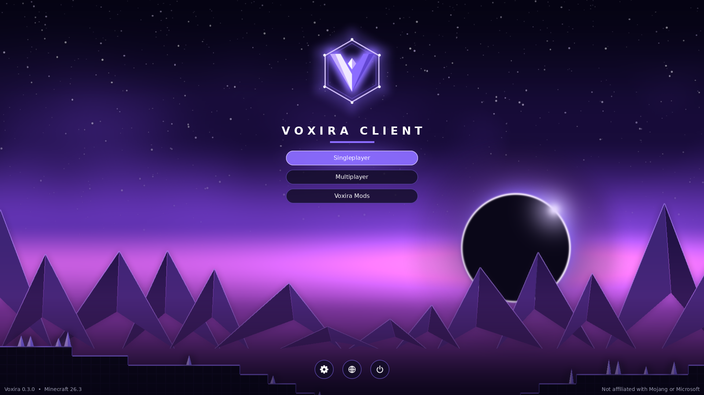

Third test build of **Voxira Client** for **Minecraft 26.3** (Fabric).

> ⚠️ Pre-release: not tested in game yet. Please report problems as an [issue](https://github.com/Real3rr0r303YT/voxira-client/issues).

## New: title screen redesign

- Violet dusk scene in four parallax layers (sky, eclipse, crystal mountains, voxel hills) that follow your mouse
- Glowing hexagon **V** emblem with a breathing glow
- Spaced **V O X I R A   C L I E N T** title
- Rounded pill buttons with hover glow
- Icon row: Options, Website, Quit
- Staggered fade-in intro

All artwork is generated by `tools/generate_menu_assets.py`, no third-party images.

## Installation
1. Fabric Loader for **26.3** (or a CurseForge custom profile with Fabric)
2. [Fabric API](https://modrinth.com/mod/fabric-api) in the `mods` folder
3. `voxira-client-0.3.0.jar` in the `mods` folder (remove the old one)
