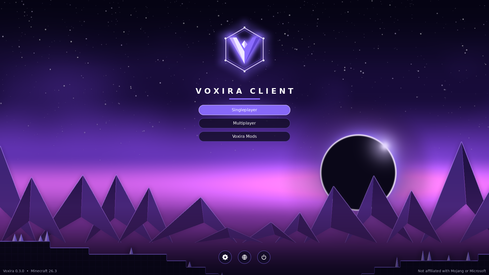

# Voxira Client

A lightweight, open-source PvP and quality-of-life client for **Minecraft 26.3**, built as a **Fabric mod**.

**🌐 Website:** https://real3rr0r303yt.github.io/voxira-client/  
**⬇️ Download:** [Releases](https://github.com/Real3rr0r303YT/voxira-client/releases)



## Features

| Module | Category | Description |
|---|---|---|
| FPS | HUD | Current frames per second |
| CPS | HUD | Clicks per second (left / right) |
| Coordinates | HUD | Position and facing direction |
| Keystrokes | HUD | WASD, mouse buttons and space bar with CPS |
| Armor Status | HUD | Armor and held item with durability |
| Ping | HUD | Latency to the server |
| Clock | HUD | Real-world time (12 h / 24 h) |
| Speed | HUD | Movement speed in blocks per second |
| Server Address | HUD | Which server you are on |
| Zoom | Visual | Hold **C**, scroll to change zoom level |
| Fullbright | Visual | Full brightness without a gamma hack |
| Custom Crosshair | Visual | Style, color, size, gap, thickness, outline |
| Low Health Warning | Visual | Pulsing red screen edge when health is low |
| Custom Main Menu | Utility | Animated Voxira title screen with parallax scene |
| Auto Reconnect | Utility | Rejoins the last server after a countdown |
| AutoLog | Safety | Leaves automatically on low health, hostile mobs, nearby players or players teleporting to you |

- **Mod menu:** press `Right Shift`. Left click a module to toggle it, right click to open its settings.
- **HUD editor:** click "Edit HUD" in the mod menu, then drag modules around. They snap to the screen edges and the center.
- **Config:** saved automatically to `.minecraft/config/voxira.json`.

### AutoLog settings

| Setting | Default |
|---|---|
| Low health | On, at 1 heart |
| Only with hostile mob near | On, within 8 blocks |
| Player nearby | Off, 32 blocks |
| Player teleports to you | Off, 12 blocks |
| Turn off after leaving | On |

> Some servers treat leaving during a fight as combat logging. Check the server rules.

## Installation

### CurseForge
1. **Minecraft → Create Custom Profile**, version `26.3`, mod loader **Fabric**
2. **Add More Content**, then search for and install **Fabric API**
3. Click **⋮ → Open Folder → `mods`** and drop in `voxira-client-<version>.jar` from the [Releases](https://github.com/Real3rr0r303YT/voxira-client/releases) page
4. Click **Play**

### Minecraft Launcher
1. Install [Fabric Loader](https://fabricmc.net/use/installer/) for `26.3`
2. Put [Fabric API](https://modrinth.com/mod/fabric-api) and `voxira-client-<version>.jar` into `%appdata%\.minecraft\mods`
3. Start the `fabric-loader-26.3` profile

## Development

Requires **JDK 25**.

```bash
./gradlew build        # the JAR ends up in build/libs/
./gradlew runClient    # launch Minecraft with the mod
```

### Project layout

```
src/main/java/dev/voxira/client/
├── VoxiraClient.java      entry point: keybinds, tick loop, HUD registration
├── config/                JSON config
├── gui/                   title screen, mod menu, settings, HUD editor, theme
│   └── menu/              title screen art helpers and buttons
├── mixin/                 Minecraft hooks (zoom, fullbright, CPS, title screen)
├── module/                module system
│   ├── hud/               draggable HUD modules
│   ├── visual/            zoom, fullbright
│   └── utility/           custom main menu
└── util/                  CPS tracker
```

### Adding a module

1. Create a class that extends `Module` (or `HudModule` for HUD elements)
2. Register it in `ModuleManager` with `add(new YourModule())`
3. Optional: add settings with `setting(new BoolSetting(...))`, `NumberSetting` or `ModeSetting`

It shows up in the mod menu automatically, and its state and settings are saved in the config.

### Publishing a release

1. Bump `mod_version` in `gradle.properties`, e.g. to `0.2.0`
2. Optionally add release notes at `.github/release-notes/v0.2.0.md`
3. Push to `main`

GitHub Actions builds the JAR and creates the tag and release automatically. `0.x` versions are marked as pre-releases.

### Title screen artwork

The title screen images are generated, not drawn by hand:

```bash
python3 tools/generate_menu_assets.py   # needs Pillow and numpy
```

Change colors or shapes in the script and run it again to update the textures.

### Website

The website lives in `website/` and is deployed to GitHub Pages on every change to `main`.

## License

[GPL-3.0](LICENSE). Not affiliated with Mojang or Microsoft.
